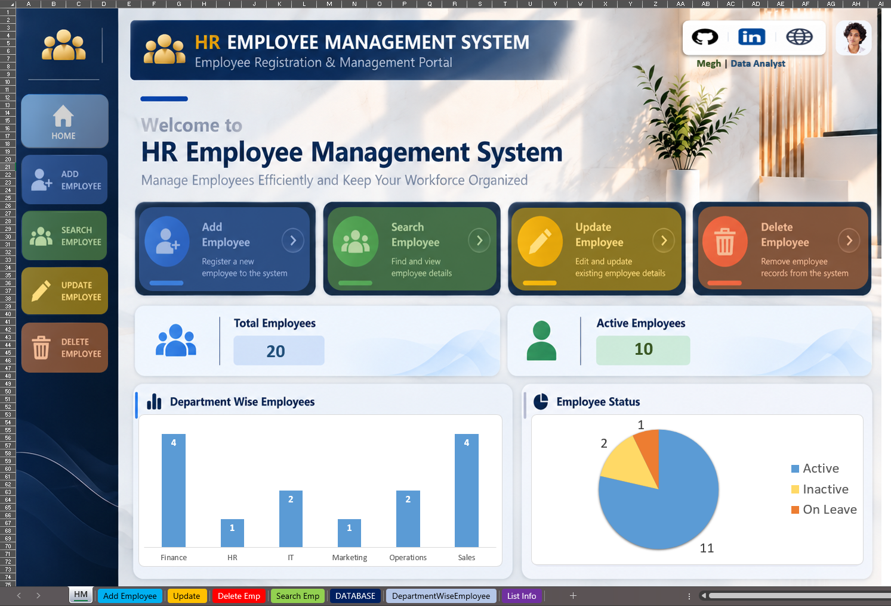

# 📊 Excel VBA HR Employee Management System

An Excel VBA project for employee record management and HR dashboard analytics.

## 🖥️ Dashboard Preview

## 🎯 Project Objective

To simplify employee record management using Excel VBA automation.

The project combines employee forms, a centralized database, and a visual dashboard.

## 🎬 Project Demo

Watch the system in action.

<video src="Macro-VBA%20Project%20(2).mp4" controls width="100%"></video>

**[▶ Watch or Download the Demo](https://github.com/Ganesh123-DA/Excel-VBA-HR-Employee-Management-System/releases/download/v1.0/Macro-VBA.Project.WOP.mp4)**

## ✨ Key Features

* ➕ **Add Employee** — Register employee details.
* 🔍 **Search Employee** — Find records using Employee ID.
* ✏️ **Update Employee** — Modify existing employee details.
* 🗑️ **Delete Employee** — Remove records with confirmation.
* 🗃️ **Centralized Database** — Store employee records in an Excel table.
* 🧭 **Dashboard Navigation** — Access forms through buttons.
* 📊 **Visual Analytics** — Explore workforce summaries.

## 📈 Dashboard Insights

The dashboard summarizes the employee dataset.

| KPI                        | Purpose                                |
| -------------------------- | -------------------------------------- |
| 👥 Total Employees         | Counts employee records                |
| 🟢 Active Employees        | Counts employees marked Active         |
| 🏢 Department Distribution | Compares employee counts by department |
| 📌 Employee Status         | Shows status distribution              |

These metrics describe the current dataset. They do not independently explain employee attrition or business performance.

## 🛠️ Tools & Technologies

* Microsoft Excel
* Excel VBA
* Excel Tables
* Data Validation
* Excel Charts
* Dashboard Design

## 🧠 Skills Demonstrated

* VBA macro automation
* CRUD operations
* Form-based data entry
* Employee record management
* KPI development
* Data visualization
* Worksheet navigation

## 🚀 How to Use

1. Download the `.xlsm` workbook below.
2. Open it in desktop Microsoft Excel.
3. Enable macros only if you trust the file.
4. Navigate through the dashboard.
5. Use the forms to manage employee records.

## ⚠️ Limitations

* Built for Excel desktop with VBA support.
* Dashboard results depend on workbook data.
* Not designed as a multi-user HR database.

## 👨‍💻 Author

**Megh**

Data Analytics | Excel | SQL | Power BI | Tableau

---

## 📥 Download Project

**[⬇️ Download Excel VBA HR Management System](https://github.com/Ganesh123-DA/Excel-VBA-HR-Employee-Management-System/blob/main/Excel-VBA-HR-Employee-Management-System.xlsm)**
